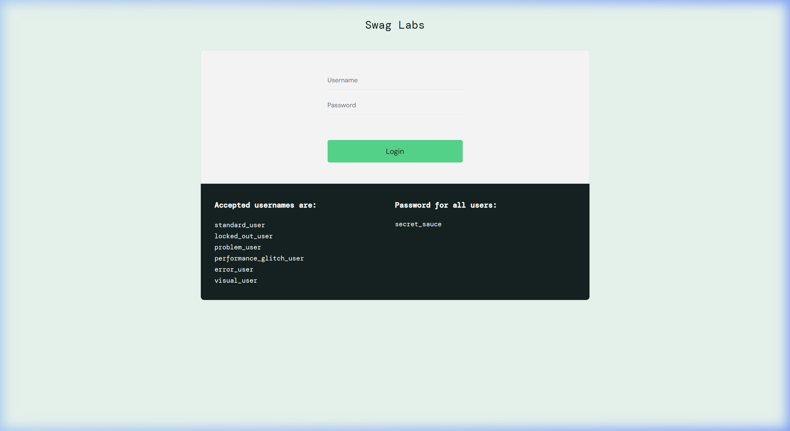
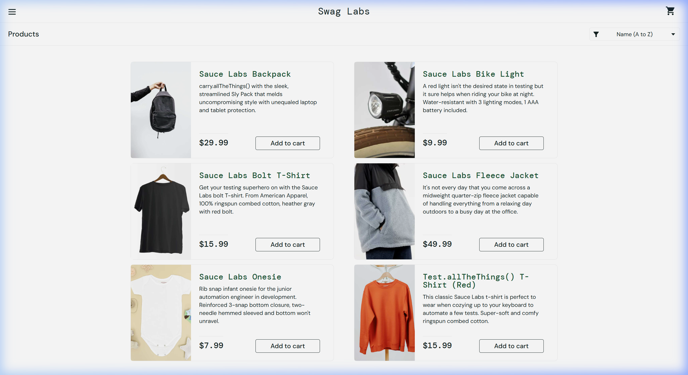
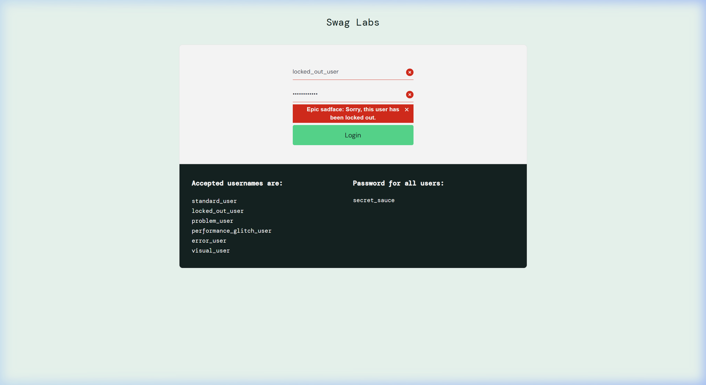
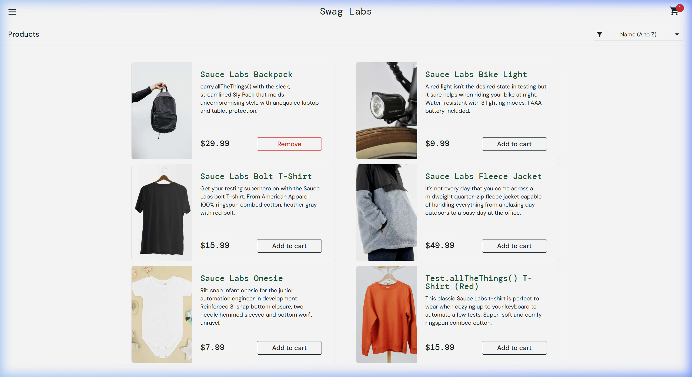
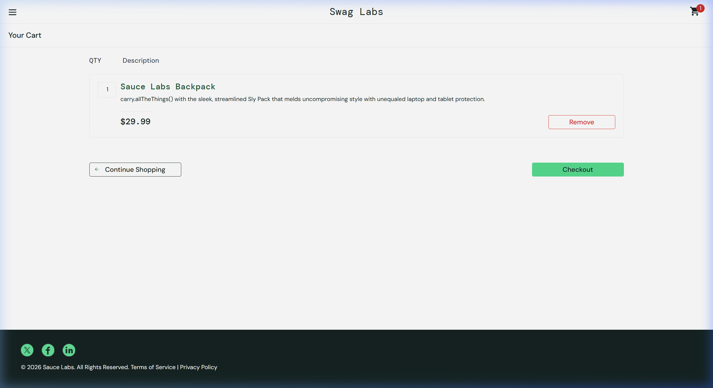
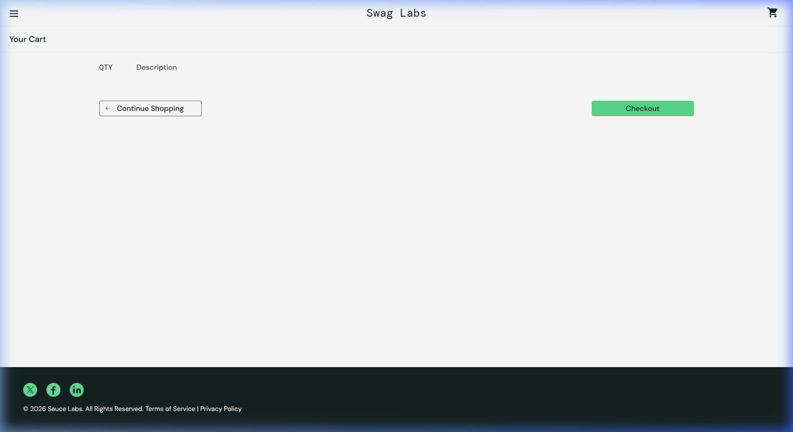
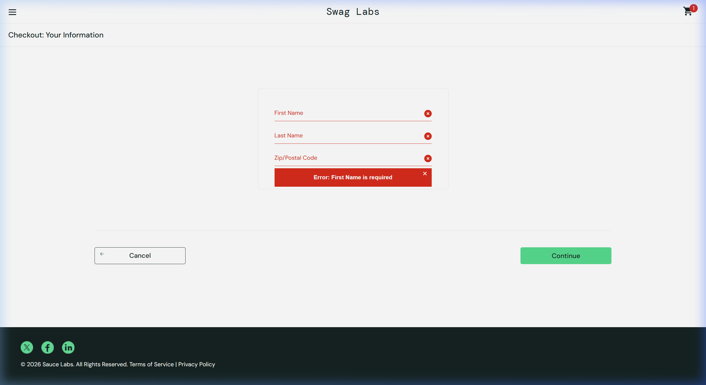

# Examen Práctico – Hito 3 · Testing & Quality Assurance
## Informe Consolidado de Pruebas de Software

**Materia:** Testing & Quality Assurance (TQA)  
**Institución:** Universidad Privada Franz Tamayo (UNIFRANZ)  
**Semestre:** Séptimo Semestre  
**Estudiante:** Miguel Mirkof Becerra Guzman  
**Fecha:** 20 de Octubre de 2026  
**Repositorio GitHub:** [https://github.com/Mirkof13/EXAMENQAH3.git](https://github.com/Mirkof13/EXAMENQAH3.git)  
**Aplicación Evaluada:** Swag Labs (SauceDemo) — [https://www.saucedemo.com/](https://www.saucedemo.com/)  

---

## 1. Introducción

El presente informe consolida los resultados y análisis del **Examen Práctico Hito 3** de la materia *Testing & Quality Assurance*. El objetivo central es aplicar de forma rigurosa las principales técnicas de aseguramiento de calidad trabajadas a lo largo de la materia:

1. **Diseño y ejecución de pruebas de Caja Negra (Black Box Testing)** sobre un aplicativo web funcional real de comercio electrónico.
2. **Registro y gestión de defectos (Bug Reporting)** siguiendo el estándar y plantilla formal de la materia.
3. **Análisis exhaustivo de Caja Blanca (White Box Testing)** sobre una función de lógica de negocio, determinando decisiones, condiciones simples, caminos de ejecución y criterios de cobertura (sentencias, decisiones y condiciones).
4. **Especificación de comportamiento mediante BDD / Gherkin**, estructurando escenarios con palabras clave formales (`Feature`, `Scenario`, `Given`, `When`, `Then`, `And`, `But`).
5. **Control de versiones y gestión ágil del trabajo con Git y GitHub Projects**, documentando el flujo de trabajo mediante Issues y un tablero Kanban.

### 1.1 Aplicación Probada

| Atributo | Detalle |
|---|---|
| **Nombre** | Swag Labs (SauceDemo) |
| **URL** | [https://www.saucedemo.com/](https://www.saucedemo.com/) |
| **Tipo de Aplicación** | Aplicación web e-commerce de una sola página (SPA) |
| **Proveedor** | Sauce Labs |
| **Ambiente de Prueba** | Producción / Web pública de demostración |
| **Navegador utilizado** | Google Chrome |
| **Sistema Operativo** | Windows |

---

## 2. Pruebas de Caja Negra

Se diseñaron y ejecutaron **5 casos de prueba funcionales** cubriendo los flujos esenciales de la plataforma: autenticación exitosa, autenticación denegada (prueba negativa), gestión del carrito de compras (adición y remoción) y validación de campos obligatorios en el checkout.

### 2.1 Resumen de Ejecución de Casos de Prueba

| ID | Título | Tipo | Prioridad | Módulo | Estado |
|---|---|---|---|---|:---:|
| **TC-001** | Inicio de sesión exitoso | Funcional | Alta | Inicio de sesión | **PASS** |
| **TC-002** | Inicio de sesión con usuario bloqueado | Negativa | Alta | Inicio de sesión | **PASS** |
| **TC-003** | Agregar un producto al carrito | Funcional | Alta | Catálogo y carrito | **PASS** |
| **TC-004** | Eliminar un producto del carrito | Funcional | Media | Catálogo y carrito | **PASS** |
| **TC-005** | Validar campos obligatorios en el checkout | Negativa | Alta | Checkout | **PASS** |

---

### 2.2 Caso TC-001 · Inicio de sesión exitoso con credenciales válidas

#### Parte 1: Diseño
- **ID del TC:** TC-001 | **Prioridad:** Alta | **Tipo:** Funcional | **Módulo:** Inicio de sesión
- **Objetivo:** Comprobar que un usuario válido (`standard_user`) accede al catálogo de productos al ingresar sus credenciales correctas.
- **Precondiciones:** Navegador abierto y sin sesión iniciada en SauceDemo.
- **Datos de prueba:** `standard_user` / `secret_sauce`.
- **Criterio de éxito:** El usuario accede al catálogo (`inventory.html`) sin mostrar errores.

#### Parte 2: Ejecución
- **Ejecutado por:** Miguel Mirkof Becerra Guzman | **Fecha:** 20/10/2026 | **Hora:** 21:35
- **Resultado:** **PASS** (100% de pasos aprobados)
- **Resultado observado:** El usuario inició sesión inmediatamente y el sistema desplegó la página de inventario con los 6 productos disponibles.

#### Evidencias del Caso TC-001:
**Figura 1.1:** Pantalla inicial de autenticación en SauceDemo.  


**Figura 1.2:** Catálogo de productos tras autenticación exitosa.  


---

### 2.3 Caso TC-002 · Inicio de sesión con usuario bloqueado

#### Parte 1: Diseño
- **ID del TC:** TC-002 | **Prioridad:** Alta | **Tipo:** Negativa | **Módulo:** Inicio de sesión
- **Objetivo:** Comprobar que un usuario bloqueado (`locked_out_user`) no puede acceder al sistema y que se muestra un mensaje de error claro.
- **Precondiciones:** Navegador abierto y sin sesión previa.
- **Datos de prueba:** `locked_out_user` / `secret_sauce`.
- **Criterio de éxito:** El acceso es denegado y se muestra el mensaje de error correspondiente.

#### Parte 2: Ejecución
- **Ejecutado por:** Miguel Mirkof Becerra Guzman | **Fecha:** 20/10/2026 | **Hora:** 21:38
- **Resultado:** **PASS**
- **Resultado observado:** El sistema rechazó el ingreso y mostró el mensaje con fondo rojo: *"Epic sadface: Sorry, this user has been locked out."*.

#### Evidencia del Caso TC-002:
**Figura 2:** Mensaje de error para usuario bloqueado.  


---

### 2.4 Caso TC-003 · Agregar un producto al carrito

#### Parte 1: Diseño
- **ID del TC:** TC-003 | **Prioridad:** Alta | **Tipo:** Funcional | **Módulo:** Catálogo y carrito
- **Objetivo:** Comprobar que un producto agregado desde el catálogo se refleja en el contador numérico y en la lista de `cart.html`.
- **Precondiciones:** Sesión iniciada con carrito vacío.
- **Datos de prueba:** Producto "Sauce Labs Backpack" ($29.99).
- **Criterio de éxito:** El producto aparece en el carrito con cantidad 1 y el contador muestra 1.

#### Parte 2: Ejecución
- **Ejecutado por:** Miguel Mirkof Becerra Guzman | **Fecha:** 20/10/2026 | **Hora:** 21:40
- **Resultado:** **PASS**
- **Resultado observado:** El botón cambió a "Remove", apareció el badge con valor "1" en el carrito, y en `cart.html` el artículo está listado correctamente.

#### Evidencias del Caso TC-003:
**Figura 3.1:** Catálogo con badge de carrito mostrando "1".  


**Figura 3.2:** Vista del carrito con el producto agregado.  


---

### 2.5 Caso TC-004 · Eliminar un producto del carrito

#### Parte 1: Diseño
- **ID del TC:** TC-004 | **Prioridad:** Media | **Tipo:** Funcional | **Módulo:** Catálogo y carrito
- **Objetivo:** Comprobar que un producto puede eliminarse del carrito y que el contador desaparece al quedar vacío.
- **Precondiciones:** Sesión iniciada con "Sauce Labs Backpack" en el carrito.
- **Datos de prueba:** Ítem en el carrito.
- **Criterio de éxito:** El producto se elimina, el badge numérico desaparece y el catálogo vuelve a ofrecer "Add to cart".

#### Parte 2: Ejecución
- **Ejecutado por:** Miguel Mirkof Becerra Guzman | **Fecha:** 20/10/2026 | **Hora:** 21:42
- **Resultado:** **PASS**
- **Resultado observado:** Al presionar "Remove", el ítem desapareció inmediatamente, el contador desapareció y el botón en el inventario volvió a "Add to cart".

#### Evidencia del Caso TC-004:
**Figura 4:** Carrito vacío tras la eliminación del producto.  


---

### 2.6 Caso TC-005 · Validar campos obligatorios en el checkout

#### Parte 1: Diseño
- **ID del TC:** TC-005 | **Prioridad:** Alta | **Tipo:** Negativa | **Módulo:** Checkout
- **Objetivo:** Comprobar que el formulario de checkout exige nombre, apellido y código postal antes de continuar.
- **Precondiciones:** Sesión iniciada con un producto en carrito, situados en el checkout paso 1.
- **Datos de prueba:** Campos en blanco (vacíos).
- **Criterio de éxito:** El sistema bloquea el avance y despliega el mensaje de campo requerido.

#### Parte 2: Ejecución
- **Ejecutado por:** Miguel Mirkof Becerra Guzman | **Fecha:** 20/10/2026 | **Hora:** 21:45
- **Resultado:** **PASS**
- **Resultado observado:** El sistema impidió el paso a la siguiente pantalla y mostró el mensaje *"Error: First Name is required"* con bordes e íconos rojos en los campos.

#### Evidencia del Caso TC-005:
**Figura 5:** Validación de campos obligatorios en el formulario de checkout.  


---

## 3. Registro de Defectos (Bugs)

Siguiendo las pautas metodológicas de la materia (*Testing & Quality Assurance* — UNIFRANZ), **los defectos se documentan exclusivamente cuando se presentan desvíos reales y reproducibles (resultado FAIL)**. Tal como señalan las directrices del examen: *"La prueba pasa → Registra Passed. No inventes un bug."*

### 3.1 Estado de Hallazgos
Durante la ejecución de los cinco casos de prueba de caja negra sobre la aplicación SauceDemo:
- Los 5 casos resultaron **PASS** (100% de éxito).
- Las funcionalidades operan conforme a su especificación de diseño.
- No se detectaron comportamientos anómalos o discrepancias.

### 3.2 Plantilla de Referencia para Reporte de Defectos
Para mantener la disponibilidad del formato en el ciclo de vida del proyecto, se anexa la plantilla formal estandarizada:

| Campo | Descripción |
|---|---|
| **#BUG-XX-X** | **Bug Report** |
| **Title** | Título breve y descriptivo del defecto |
| **Descripción** | Explicación detallada del problema y su contexto |
| **Pasos** | Pasos reproducibles numerados (incluye referencia al TC) |
| **Resultado actual** | Comportamiento anómalo observado |
| **Resultado esperado** | Comportamiento correcto según especificación |
| **Prioridad** | Escala 1 a 5 (1 = Muy Alta, 5 = Muy Baja) |
| **Severidad** | Escala 1 a 5 (1 = Crítica, 5 = Trivial) |
| **Ambiente** | SO, Navegador, Versión, Tipo de Dispositivo |
| **Adjuntos** | Capturas o videos que evidencian la falla |
| **Comentarios** | Impacto en el usuario y notas técnicas |

---

## 4. Análisis de Pruebas de Caja Blanca

### 4.1 Código Analizado
Se analizó la siguiente función implementada en Python:

```python
def validar_compra(edad, cuenta_activa, saldo, monto):
    if edad < 18:
        return "Compra no permitida: edad"
    if not cuenta_activa:
        return "Compra no permitida: cuenta"
    if saldo >= monto and monto > 0:
        return "Compra aprobada"
    return "Compra rechazada"
```

### 4.2 Decisiones y Condiciones Simples

| ID | Expresión | Tipo | Línea |
|---|---|---|---|
| **D1** | `edad < 18` | Decisión simple | `if edad < 18:` |
| **C1** | `edad < 18` | Condición simple | Evaluada en D1 |
| **D2** | `not cuenta_activa` | Decisión simple | `if not cuenta_activa:` |
| **C2** | `cuenta_activa` | Condición simple | Evaluada en D2 (negada) |
| **D3** | `saldo >= monto and monto > 0` | Decisión compuesta | `if saldo >= monto and monto > 0:` |
| **C3** | `saldo >= monto` | Condición simple | Primera rama del operador `and` |
| **C4** | `monto > 0` | Condición simple | Segunda rama del operador `and` |

| ID Sentencia | Sentencia return | Salida generada |
|---|---|---|
| **S1** | `return "Compra no permitida: edad"` | Compra no permitida por edad |
| **S2** | `return "Compra no permitida: cuenta"` | Compra no permitida por cuenta inactiva |
| **S3** | `return "Compra aprobada"` | Compra aprobada |
| **S4** | `return "Compra rechazada"` | Compra rechazada |

### 4.3 Criterio de Cobertura y Justificación del Mínimo
- **Criterio seleccionado:** **Cobertura de Decisiones (Decision Coverage)**. Exige que cada punto de bifurcación tome los valores Verdadero y Falso al menos una vez. Al recorrer todos los resultados de las decisiones, se garantiza automáticamente el 100% de **Cobertura de Sentencias**.
- **Cálculo del mínimo:** Existen 4 caminos independientes de ejecución:
  1. Camino 1: D1 = True → S1
  2. Camino 2: D1 = False, D2 = True → S2
  3. Camino 3: D1 = False, D2 = False, D3 = True → S3
  4. Camino 4: D1 = False, D2 = False, D3 = False → S4
  
  Por tanto, el **mínimo matemático necesario para cobertura de decisiones es de 4 casos**.

### 4.4 Evaluación de los 3 Casos Iniciales Diseñados

| Caso | `edad` | `cuenta_activa` | `saldo` | `monto` | Resultado Esperado | Decisión / Sentencia Cubierta |
|---|:---:|:---:|:---:|:---:|---|---|
| **CB1** | 15 | True | 500 | 100 | "Compra no permitida: edad" | D1 = True (S1) |
| **CB2** | 25 | False | 500 | 100 | "Compra no permitida: cuenta" | D1 = False, D2 = True (S2) |
| **CB3** | 30 | True | 500 | 200 | "Compra aprobada" | D1 = False, D2 = False, D3 = True (S3) |

#### Ajuste Necesario
Con los tres casos anteriores se obtiene:
- Cobertura de decisiones: **5 / 6 resultados (83.3%)** — La decisión D3 nunca resulta Falsa.
- Cobertura de sentencias: **3 / 4 sentencias (75.0%)** — S4 nunca se ejecuta.

**Ajuste:** Se incorpora el caso **CB4**:
- Datos: `edad = 30`, `cuenta_activa = True`, `saldo = 50`, `monto = 100`.
- Salida esperada: `"Compra rechazada"`.
- Cobertura adicional: **D3 = False**, ejecutando la sentencia **S4**.
- Con CB1, CB2, CB3 y CB4 se alcanza el **100% de Cobertura de Decisiones y 100% de Sentencias**.

### 4.5 Cobertura de Condiciones como Complemento
La cobertura de condiciones simples exige que C1, C2, C3 y C4 tomen valores Verdadero y Falso. Debido a la evaluación en cortocircuito (*short-circuit*) del operador `and` en Python, cuando `saldo >= monto` es Falso, no se evalúa `monto > 0`. Con CB4 (`saldo < monto`), C4 no toma valor Falso.  
Para cubrir **C4 = False**, se requiere el caso **CB5**:
- `edad = 30`, `cuenta_activa = True`, `saldo = 500`, `monto = 0`.
- Resultado: `"Compra rechazada"`.
- Mínimo total para cobertura de condiciones simples: **5 casos**.

---

## 5. Escenarios Gherkin (BDD)

Se redactaron escenarios BDD estructurados con `Feature`, `Scenario`, `Given`, `When`, `Then`, `And`, `But` para las 3 funcionalidades principales probadas en SauceDemo:

```gherkin
Feature: Inicio de sesión en Swag Labs
  Como usuario de la tienda SauceDemo
  Quiero autenticarme con mis credenciales
  Para acceder al catálogo de productos

  Scenario: Acceso exitoso con usuario estándar
    Given que estoy en la página de login de SauceDemo
    And los campos de usuario y contraseña están vacíos
    When ingreso "standard_user" en el campo Username
    And ingreso "secret_sauce" en el campo Password
    And presiono el botón Login
    Then debería acceder al catálogo de productos
    And debería ver el título "Products"

  Scenario: Acceso denegado con usuario bloqueado
    Given que estoy en la página de login de SauceDemo
    And no tengo una sesión activa
    When ingreso "locked_out_user" en el campo Username
    And ingreso "secret_sauce" en el campo Password
    And presiono el botón Login
    Then debería mostrarse el mensaje "Epic sadface: Sorry, this user has been locked out."
    But no debería acceder al catálogo de productos

  Scenario: Credenciales incorrectas
    Given que estoy en la página de login de SauceDemo
    When ingreso el usuario "standard_user" y una contraseña incorrecta
    And presiono el botón Login
    Then debería mostrarse un mensaje de error
    And debería permanecer en la página de login
```

```gherkin
Feature: Gestión del carrito de compras
  Como usuario autenticado en SauceDemo
  Quiero agregar y eliminar productos del carrito
  Para controlar mi lista de compras antes del checkout

  Scenario: Agregar un producto al carrito
    Given que inicié sesión como "standard_user"
    And el carrito está vacío
    When presiono Add to cart del producto "Sauce Labs Backpack"
    Then el botón del producto cambia a "Remove"
    And el contador del carrito muestra 1

  Scenario: Eliminar un producto del carrito
    Given que el carrito contiene el producto "Sauce Labs Backpack"
    When presiono Remove en la página del carrito
    Then el producto desaparece de la lista
    And el contador del carrito desaparece
```

```gherkin
Feature: Validación de campos obligatorios en el checkout
  Como cliente en el proceso de compra
  Quiero que el formulario valide los campos obligatorios
  Para asegurar que la orden contenga la información requerida

  Scenario: Checkout con campos vacíos
    Given que estoy en la página Checkout: Your Information
    When dejo vacío el campo First Name
    And presiono Continue
    Then debería mostrarse el mensaje "Error: First Name is required"
    And no debería avanzar a la siguiente página

  Scenario: Checkout con datos completos
    Given que estoy en la página Checkout: Your Information
    When completo First Name, Last Name y Postal Code con datos válidos
    And presiono Continue
    Then debería avanzar a la página Checkout: Overview
```

---

## 6. Organización en GitHub: Issues y Project Board

De acuerdo con lo solicitado en las instrucciones del examen, el proyecto fue gestionado mediante Git y organizado con **GitHub Issues** y un **Project Board Kanban**:

### 6.1 Columnas y Estado de Tareas en el Tablero

| Tarea (Issue) | Responsable | Estimación | Estado en Board | Enlace / Archivo Asociado |
|---|---|---|:---:|---|
| #1: Diseñar casos de prueba de caja negra | Miguel Mirkof | 2h | **Done** | `docs/casos_caja_negra.md` |
| #2: Ejecutar casos y registrar evidencias | Miguel Mirkof | 2h | **Done** | `evidencias/capturas/` |
| #3: Realizar análisis de caja blanca y cobertura | Miguel Mirkof | 2h | **Done** | `docs/analisis_caja_blanca.md` |
| #4: Redactar escenarios BDD en Gherkin | Miguel Mirkof | 1h | **Done** | `docs/escenarios_gherkin.md` |
| #5: Evaluar y documentar registro de bugs | Miguel Mirkof | 1h | **Done** | `bugs/bugs_encontrados.md` |
| #6: Consolidar informe final en formato Word y PDF | Miguel Mirkof | 2h | **Done** | `entregable/informe_hito3.pdf` |
| #7: Estructurar repositorio y actualizar README | Miguel Mirkof | 1h | **Done** | `README.md` |

---

## 7. Conclusiones

1. **Efectividad de las pruebas de caja negra:** Los 5 casos diseñados permitieron verificar los flujos críticos de SauceDemo (autenticación positiva y negativa, operaciones reactivas de carrito y validación de formularios). La ejecución confirmó la estabilidad de la plataforma demostrativa (100% PASS).
2. **Importancia del análisis de caja blanca:** El análisis riguroso de `validar_compra` demostró que 3 casos de prueba eran insuficientes para lograr cobertura completa de decisiones (83.3%), requiriéndose un 4to caso (CB4) para alcanzar el 100% de decisiones y sentencias, y un 5to caso (CB5) para cubrir todas las ramas de condiciones simples.
3. **Claridad del enfoque BDD con Gherkin:** La redacción en Gherkin proporciona una especificación viva, comprensible para perfiles técnicos y de negocio, sirviendo como base directa para la automatización con Cucumber o Playwright/Cypress.
4. **Trazabilidad y control de versiones:** La estructura modular del repositorio individual y el uso de Git y GitHub garantizan la reproducibilidad, transparencia y profesionalismo en la entrega académica.

---

## 8. Referencias

- Sauce Labs. (s. f.). *Swag Labs* [Aplicación web de demostración]. https://www.saucedemo.com/
- Universidad Privada Franz Tamayo. (s. f.). *Caja blanca y Gherkin* [Diapositivas de clase]. Testing y Quality Assurance.
- Universidad Privada Franz Tamayo. (s. f.). *Examen práctico Hito 3 TQA: Instrucciones* [Diapositivas]. Testing y Quality Assurance.
- Universidad Privada Franz Tamayo. (s. f.). *Plantilla para diseño y ejecución de casos de prueba* [Documento de clase]. Testing y Quality Assurance.
- Universidad Privada Franz Tamayo. (s. f.). *Técnicas de pruebas de caja blanca* [Diapositivas de clase]. Testing y Quality Assurance.
